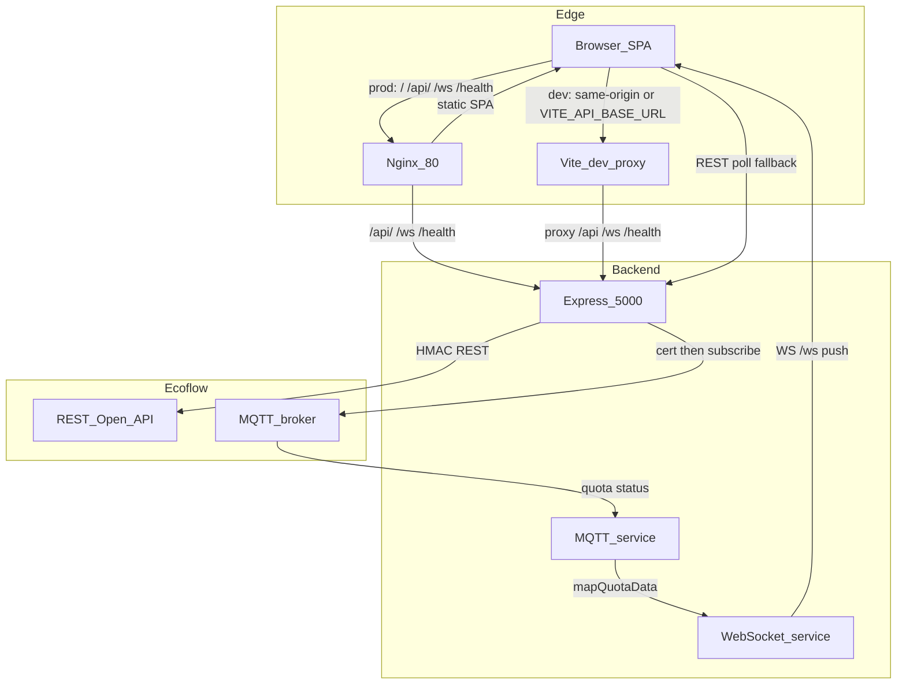
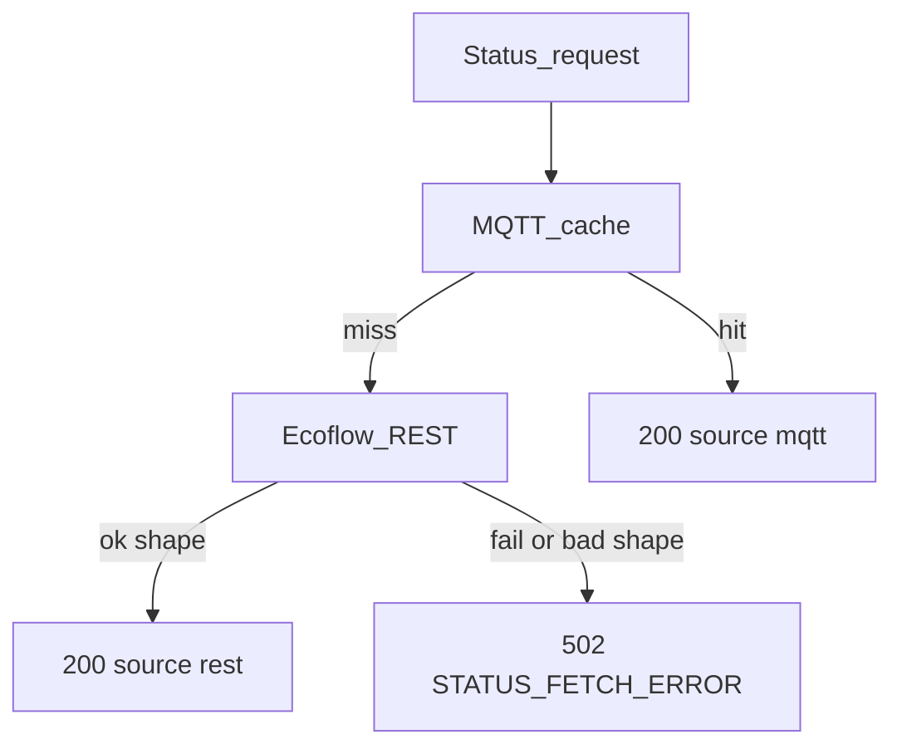

# Architecture — Ecoflow Monitor

Real-time monitoring for Ecoflow devices (Delta 3 Max Plus, Delta 3 Plus, Smart Plug, and related SKUs).

**Supported SKUs:** Delta 3 Max Plus and Delta 3 Plus are supported. Vendor PDF coverage exists for Max / Max Plus only; Plus shares the same heartbeat/quota family as Max / Max Plus (`cmsBattSoc`, `powInSumW` / `powOutSumW`, `cmsChgDsgState`) until a live quota dump proves otherwise.

Planning baseline (device docs vs code gaps, roadmap): [PROJECT_ASSESSMENT.md](./PROJECT_ASSESSMENT.md).

## Stack

| Layer | Technology |
|-------|------------|
| Runtime | Node.js 22 LTS (`node:22-alpine`) |
| Backend | Express **5**, TypeScript, Zod **4**, Winston, Helmet, MQTT, `ws`, prom-client |
| Frontend | React **19.3**, Vite **8**, Tailwind **4** (`@tailwindcss/vite`), React Router **7**, TanStack Query 5 |
| Shared | npm workspace `@ecoflow/shared` (types, constants, `mapQuotaData`) |
| Tests | Vitest (server + client) |
| Prod edge | `nginx:1.27-alpine` → SPA + reverse proxy |

Install tip: workspace installs often need `npm install --legacy-peer-deps` (Dockerfiles use the same flag).

## High-level flow

End-to-end runtime path (prod edge vs local/dev proxy):


- Browser uses **same-origin** `/api` and `/ws` by default (Nginx proxies them in prod; Vite proxies in local/dev when `VITE_API_BASE_URL` is empty).
- `VITE_API_BASE_URL` overrides the API origin when needed. Dev Compose sets it to `http://localhost:5000` (browser → host-mapped Express) and `VITE_API_BASE_URL_DOCKER=http://server:5000` for the Vite proxy target inside the container.
- **Not** exposed on port 80: `/metrics`, `/api-docs` (available on Express `:5000` only).

## Monorepo layout

```
ecoflow-dashboard/
├── server/          # Express API, MQTT, WebSocket
├── client/          # React SPA (Vite)
├── shared/          # @ecoflow/shared
├── docker-compose.yml
├── docker-compose.dev.yml
├── .env.example
├── ARCHITECTURE.md
└── README.md
```

Dev Dockerfiles build from **repo root** with workspaces (`WORKDIR /app`, packages under `/app/{client,server,shared}`). Compose volumes mount sources under those paths.

## Shared package (`@ecoflow/shared`)

Single workspace package imported by server and client:

- Types: device / status shapes
- Constants: `REFETCH_INTERVALS`, API / MQTT / WebSocket defaults
- `mapQuotaData`: Delta 3 / related quota field mapping (Max Plus, Plus same-family keys; Pro legacy `/10` watts); **conditional `/10`** only for documented 0.1 W watt fields (`isTenthWatt`)

MQTT certificate response types stay **server-only**.

## Authentication (Ecoflow Open API)

**HMAC-SHA256 + ACCESS_KEY** (not OAuth2 / CLIENT_ID).

1. Server reads `ECOFLOW_ACCESS_KEY` and `ECOFLOW_SECRET_KEY` from env (Zod-validated).
2. Each outbound request builds a sorted query string, appends `accessKey`, `nonce`, `timestamp`, then signs with HMAC-SHA256 (`secretKey`).
3. Headers sent: `accessKey`, `nonce`, `timestamp`, `sign`.

Credentials never leave the backend.

## Real-time data path

Hybrid: **MQTT → WebSocket → React Query HTTP polling fallback**.

1. When MQTT is enabled, the server calls Ecoflow `GET /iot-open/sign/certification` to obtain broker URL, port, protocol, and `certificateAccount` / `certificatePassword`.
2. MQTT subscribe topics follow `/open/{certificateAccount}/{sn}/quota|status`.
3. Parsed quota uses shared `mapQuotaData`; updates are pushed to browsers over `WS /ws`.
4. Status route prefers MQTT cache; on miss it falls back to REST.
5. Client React Query polls REST as a safety net (see intervals below).

Status for `GET /api/devices/:deviceId/status`:



### Client polling & rate limit

Defined in `shared/src/constants` (`REFETCH_INTERVALS`) and `client/src/constants` (`RATE_LIMIT_CONFIG`):

| Constant | Value | Role |
|----------|-------|------|
| `DEVICES` | 60 s | Device list refetch |
| `DEVICE_STATUS` | 30 s | Status poll when WebSocket is unavailable |
| `DEVICE_STATUS_WS` | 60 s | Light REST check while MQTT/WS pushes live updates |
| Client rate limit | 10 req / 60 s | Axios client limiter — intervals tuned to stay under this |

Server Express rate limit (separate): 100 req / 15 min in production (`RATE_LIMIT` in shared).

### Honest status errors

If MQTT has no data **and** REST fails (or returns an unexpected shape): **HTTP 502** with

```json
{ "error": { "message": "...", "code": "STATUS_FETCH_ERROR" } }
```

No fake `batteryLevel: 0` / invented standby SOC. The UI shows an error / unavailable state.

## Backend endpoints

| Method | Path | Notes |
|--------|------|--------|
| GET | `/health` | Liveness |
| GET | `/ready` | Readiness: MQTT connected (if enabled) + at least one successful Ecoflow/MQTT data timestamp |
| GET | `/api/devices` | Device list |
| GET | `/api/devices/:deviceId/status` | Hybrid status (`source`: `mqtt` \| `rest`) or 502 |
| GET | `/api/devices/connection-status` | MQTT / WebSocket connection info |
| WS | `/ws` | Real-time status push |
| GET | `/api-docs` | Swagger (dev-friendly; not on Nginx :80) |
| GET | `/metrics` | Prometheus (not on Nginx :80) |

## Ops notes

- **Logging:** Winston → stdout JSON in production (no `logs/` files in the image).
- **Env:** Zod schema in `server/src/config/env.ts`.
- **Helmet:** `script-src` includes `unsafe-eval` only when `NODE_ENV === 'development'` (Swagger UI).
- **CSP (Nginx):** `connect-src 'self' ws: wss:` — browser does not call Ecoflow directly.

## Environment variables

See root `.env.example`. Required:

- `ECOFLOW_ACCESS_KEY`, `ECOFLOW_SECRET_KEY`, `ECOFLOW_API_BASE_URL`
- `PORT` (default `5000`), `NODE_ENV`

Optional MQTT / WebSocket:

- `ECOFLOW_MQTT_ENABLED` (credentials normally from certification endpoint)
- `ECOFLOW_MQTT_BROKER_URL`, `ECOFLOW_MQTT_CLIENT_ID`, …
- `WEBSOCKET_ENABLED`, `WEBSOCKET_PATH` (default `/ws`)
- `CORS_ORIGIN`

Frontend:

- `VITE_API_BASE_URL` — optional override; empty = same-origin
- Dev Docker may set `VITE_API_BASE_URL_DOCKER=http://server:5000` for Vite proxy target

## Docker

**Production** (`docker-compose.yml`): multi-stage server image + Nginx client; healthchecks on `/health` (server) and SPA root (client). Nginx proxies `/api/`, `/ws`, `/health` to `server:5000`.

**Development** (`docker-compose.dev.yml`): workspace-aware `Dockerfile.dev` builds from repo root with `--legacy-peer-deps`; hot reload via volumes under `/app/{client,server,shared}`.

```bash
docker compose -f docker-compose.dev.yml up --build
docker compose up -d --build
```

## Out of scope (current pass)

History DB / charts, CI pipelines, multi-user auth, public metrics auth (metrics stay off Nginx :80).
